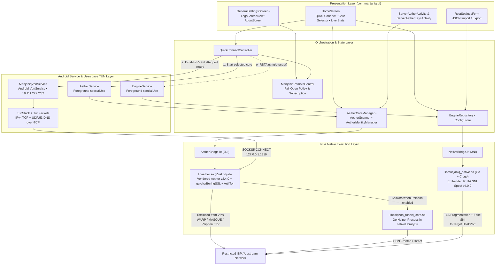
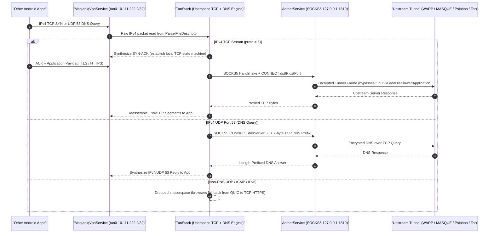

<div align="center">


# Manjaniq · منجنیق

**Modular Multi-Core Censorship-Circumvention & DPI-Bypass Client for Android**

Rootless Android networking client combining the Rust-based **Aether** circumvention engine (WARP, MASQUE, Psiphon, Tor, ECH) and the Go-based **RSTA** TLS SNI fragmentation/spoofing proxy, paired with an optional userspace `VpnService` **Quick Connect** tunnel.

[](https://github.com/ehrigit/Manjaniq/actions/workflows/build-debug.yml)
[-3DDC84?logo=android&logoColor=white)](#requirements)
[](#technology-stack)
[](#networking-cores)
[](#localization)
[](#license)

[Overview](#overview) •
[Features](#features) •
[Architecture](#architecture-overview) •
[Networking Cores](#networking-cores) •
[Quick Connect](#quick-connect-architecture) •
[Building](#building-the-project) •
[Usage](#configuration-and-usage) •
[License](#license)

</div>

---

<details>
<summary><strong>Table of Contents</strong></summary>

1. [Overview](#overview)
2. [Features](#features)
3. [Architecture Overview](#architecture-overview)
4. [Networking Cores](#networking-cores)
   - [Core Comparison](#core-comparison)
   - [Aether Core (Rust v2.4.0)](#aether-core-rust-v240)
   - [RSTA Core (Go v4.0.0)](#rsta-core-go-v400)
5. [Quick Connect Architecture](#quick-connect-architecture)
6. [Project Structure](#project-structure)
7. [Technology Stack](#technology-stack)
8. [Requirements](#requirements)
9. [Building the Project](#building-the-project)
10. [Configuration and Usage](#configuration-and-usage)
11. [Localization](#localization)
12. [CI/CD and Testing](#cicd-and-testing)
13. [Limitations and Compatibility](#limitations-and-compatibility)
14. [Contributing](#contributing)
15. [Credits and Acknowledgments](#credits-and-acknowledgments)
16. [License](#license)

</details>

---

## Overview

**Manjaniq** (`com.manjaniq`, current version `0.1.0`) is an open-source Android networking client built for restrictive and heavily filtered network environments where Deep Packet Inspection (DPI), TLS Server Name Indication (SNI) blocking, UDP/QUIC throttling, and IP range filtering disrupt standard connectivity.

Rather than forcing every scenario through a single protocol, Manjaniq integrates two fundamentally different native engines under one Material 3 interface:

- **Aether (`libaether.so`, Rust v2.4.0):** A full general-purpose censorship-circumvention tunnel client exposing a local **SOCKS5** proxy (`127.0.0.1:1819` by default). It supports Cloudflare WARP WireGuard, MASQUE (HTTP/3 QUIC and HTTP/2 TCP), multi-hop Warp-in-Warp (`gool`), MASQUE-in-MASQUE (`mim`), WireGuard-over-MASQUE, clean-endpoint scanning, UDP packet obfuscation, TLS ClientHello fingerprinting/fragmentation, Encrypted ClientHello (ECH), and integrated **Psiphon** and **Tor** chaining.
- **RSTA (`libmanjaniq_native.so`, Go v4.0.0):** An embedded port of the **RSTA SNI Spoof** engine exposing a local **single-destination TCP TLS relay** (`0.0.0.0:40443` by default). It forwards TCP connections to a configured target host/IP while applying TLS record splitting, ClientHello fragmentation, and low-TTL fake-SNI probing to bypass middlebox SNI inspection.

Manjaniq supports **two distinct operating modes** without requiring root access:
1. **Manual Local-Proxy Mode:** Starts the selected engine inside an Android foreground service (`AetherService` or `EngineService`) as a local listener only, leaving system-wide Android routing untouched.
2. **Quick Connect VPN Mode:** Orchestrates engine startup, verifies loopback port readiness, and brings up `ManjaniqVpnService` — a pure-Kotlin userspace IPv4 `VpnService` TUN-to-SOCKS5 relay that routes device TCP and DNS traffic through the local SOCKS5 proxy while excluding Manjaniq itself from capture.

---

## Features

### Multi-Core Engine Management
- **Dual Native Cores:** Switch between **Aether** (Rust JNI) and **RSTA** (Go/C JNI) directly from the Home screen.
- **Independent Foreground Services:** Dedicated lifecycle management, persistent status notifications, and stop actions via `AetherService` and `EngineService`.
- **Android 10+ W^X Compliance:** All native engines and the `libpsiphon_tunnel_core.so` sidecar helper are packaged under `jniLibs/<abi>/` and executed from Android's `nativeLibraryDir`, complying with `noexec` app-data enforcement on API 29+.

### One-Tap Quick Connect VPN
- **Full-Device Tunneling (with Aether):** Single-tap circular **Quick Connect** control on the Home screen handles VPN permission consent, starts the selected core, waits for local proxy readiness, and establishes an Android `VpnService` session.
- **Userspace TUN-to-SOCKS5 Stack:** In-process packet engine (`TunStack` + `TunPackets`) translates IPv4 TCP streams into SOCKS5 `CONNECT` sessions and wraps UDP port 53 DNS lookups into DNS-over-TCP via SOCKS5.
- **Loop-Free Routing:** Excludes `com.manjaniq` via `VpnService.Builder.addDisallowedApplication` so outbound engine sockets reach the physical network directly.

### Aether Circumvention Suite
- **5 Tunnel Protocols:** `masque`, `wg` (WireGuard), `gool` (Warp-in-Warp), `mim` (MASQUE-in-MASQUE), and `wg-over-masque`, over **HTTP/3 (QUIC)** or **HTTP/2 (TCP)** transports.
- **Clean-Endpoint Scanner:** Built-in scanner (`turbo`, `balanced`, `thorough`, `verified`, `ironclad`) to discover reachable Cloudflare WARP/MASQUE endpoints on filtered ISP networks.
- **DPI & TLS Evasion:** 7 UDP `--noize` obfuscation presets (`auto`, `off`, `light`, `firewall`, `balanced`, `gfw`, `aggressive`), 5 TLS ClientHello fingerprints (`chrome`, `chrome-120`, `firefox`, `semi-python`, `go`), HTTP/2 TLS ClientHello fragmentation (`1–517` bytes, `0–500` ms delay), and Encrypted ClientHello (**ECH**) over UDP, TCP, or DoH resolvers.
- **Integrated Psiphon & Tor Topologies:** Run **Psiphon** or embedded **Tor** (`arti-client`) `Inside Tunnel (Exit)`, `Before Tunnel (Entry)`, or standalone (`Psiphon Only` / `Tor Only`). Includes 9 Psiphon CDN fronting provider sets, localized ISO exit-country selection backed by an RSA-SHA256-verified bootstrap server list, and Tor bridge configuration.
- **Atomic Key Provisioning & Censored-Network Enrollment:** Dedicated **Get Aether Keys** screen (`ServerAetherKeysActivity`) registers and renews WireGuard, MASQUE, and inner/outer multi-hop identities atomically, with automatic proxy relay detection over local ports or an active RSTA listener when direct Cloudflare API access is blocked.
- **URI Sharing & Raw CLI Mode:** Import/export `aether://` profile URIs or hand-edit the underlying Aether CLI invocation directly.

### RSTA TLS DPI-Bypass Proxy
- **3 Bypass Methods & 4 Fragmentation Strategies:** Choose `fragment`, `fake_sni`, or `combined` alongside `sni_split`, `half`, `multi` (24-byte chunks), or `tls_record_frag`.
- **Fake-Hello TTL Probe:** Configurable fake SNI hostname (default `cdnjs.cloudflare.com`), TTL trick toggle, and inter-fragment delay (`0–5` seconds).
- **JSON Portability & Live Telemetry:** Import, export, copy, or reset genuine RSTA `config.json` profiles, and monitor active/total connections, confirmed bypasses, blocked attempts, and 256 KB-stepped traffic counters in real time.

### Observability, Localization & Policy Controls
- **Real-Time Diagnostics:** Live **Logs** viewer with severity filtering (`All`, `Info`, `Warn`, `Error`), pause/resume display lock, clipboard export, buffer clear, and real-profile HTTP delay testing.
- **Bilingual English & Persian (`فارسی`) UI:** Instant in-app language switching with automatic Right-to-Left (RTL) layout mirroring across Compose screens and native configuration editors.
- **Fail-Open Remote Policy & Subscription Module:** Self-contained `com.manjaniq.remotecontrol` package supporting optional remote maintenance/update/access gates, zero-permission installation registration, and subscription/traffic quota display in Settings — engineered to fail open whenever unconfigured or unreachable.

---

## Architecture Overview

Manjaniq is structured into four distinct layers: Jetpack Compose / Material UI, Kotlin domain controllers, Android foreground/VPN services, and dual JNI native engines (`libaether.so` in Rust and `libmanjaniq_native.so` in Go + C).



### Architectural Highlights

- **Strict Process Exclusion for VPN Traffic:** `ManjaniqVpnService` calls `addDisallowedApplication(packageName)` on its `VpnService.Builder`. Traffic from all other apps enters the `tun0` file descriptor, is parsed in userspace by `TunStack`, and is forwarded over loopback to `127.0.0.1:<listenPort>`, while Manjaniq's own outbound WARP/MASQUE/Psiphon/Tor/RSTA sockets bypass `tun0` and egress directly over Wi-Fi or mobile data.
- **Unified Native Logging:** `aether-wrapper/src/lib.rs` installs a custom Rust `tracing_subscriber` layer storing a 512-line UTF-8 ring buffer alongside a background `logcat -s AetherCore:V` reader in `AetherCoreManager`, while `engine/rstaspoof/engine.go` maintains a thread-safe 500-entry structured ring buffer polled over JNI by `EngineRepository`.
- **Isolated Control-Plane Seam:** All remote policy, device registration, and subscription logic lives exclusively in `com.manjaniq.remotecontrol` behind small lifecycle hooks in `MainActivity`, `AetherService`, `EngineService`, and `QuickConnectController`. Network errors, timeouts, HTTP 5xx responses, and malformed payloads always allow normal offline/online app operation.

---

## Networking Cores

> **Important Distinction:** **Aether** and **RSTA** are architecturally different engines designed for different networking roles. They are **not** interchangeable protocols.

### Core Comparison

| Characteristic | Aether Core (`libaether.so`) | RSTA Core (`libmanjaniq_native.so`) |
| :--- | :--- | :--- |
| **Upstream Engine** | [`CluvexStudio/Aether`](https://github.com/CluvexStudio/Aether) **v2.4.0** | [`rstagit`](https://github.com/rstagit) RSTA SNI Spoof **v4.0.0** |
| **Implementation Language** | Rust (`aether-wrapper` JNI `cdylib` + C++/BoringSSL `quiche`) | Go 1.22 + C (`native/bridge.go` & `bridge.c` via `cgo`) |
| **Local Listener Type** | **SOCKS5 proxy** (arbitrary destination routing) | **Fixed-target TCP TLS relay** (single `CONNECT_IP:CONNECT_PORT`) |
| **Default Listen Address** | `127.0.0.1:1819` (configurable port) | `0.0.0.0:40443` (configurable host & port) |
| **Full-Device Quick Connect VPN** | **Supported** (routes device TCP + DNS via SOCKS5) | **Not supported for general browsing** (single-target non-SOCKS relay) |
| **Supported Android ABIs** | `arm64-v8a`, `x86_64` (64-bit only) | `arm64-v8a`, `x86_64` (32-bit cross-build helpers also present) |
| **Primary Use Case** | Full internet circumvention via WARP, MASQUE, Psiphon, or Tor | Targeted DPI/SNI bypass to a specific TLS server, CDN edge, or upstream proxy |

---

### Aether Core (Rust v2.4.0)


Aether is vendored in `third_party/Aether` at upstream release **v2.4.0** and compiled into `libaether.so` through the `aether-wrapper` Rust crate (`features = ["tor"]`). `AetherCoreManager` prepares writable runtime directories (`filesDir/aether`, `cacheDir/aether-tmp`), writes an Android system CA bundle (`cacert.pem`) for `rustls`/OpenSSL verification, stages environment variables via JNI (`aether_env_reset` / `aether_env_set`), and launches the tunnel in-process via `aether_core_start`.

#### Supported Tunnel Protocols & Transports
- **Protocols (`--protocol`):**
  - `masque` — Cloudflare WARP over HTTP/3 QUIC (`h3`) or HTTP/2 TLS/TCP (`h2`).
  - `wg` — Cloudflare WARP over WireGuard UDP.
  - `gool` — **Warp-in-Warp**: inner WireGuard peer tunneled inside an outer WireGuard tunnel across distinct endpoints.
  - `mim` — **MASQUE-in-MASQUE**: inner MASQUE session nested inside an outer MASQUE carrier.
  - `wg-over-masque` — Inner WireGuard tunnel carried inside an outer MASQUE session.
- **Clean-Endpoint Scanner (`--scan`):** `turbo`, `balanced` (default), `thorough`, `verified`, and `ironclad` modes via `AetherScanner`, supporting both single-hop and distinct outer/inner dual-hop endpoint discovery.
- **UDP & TLS Evasion:**
  - **UDP Obfuscation (`--noize`):** `auto`, `off`, `light`, `firewall`, `balanced`, `gfw`, `aggressive`.
  - **TLS ClientHello Fingerprints (`--tls-fingerprint`):** `chrome`, `chrome-120`, `firefox`, `semi-python`, `go` (applied on HTTP/2 MASQUE).
  - **HTTP/2 TLS Fragmentation (`--fragment-size`, `--fragment-delay`):** Splits TLS ClientHello records into `1–517` byte chunks (fixed value or `min-max` range) with `0–500` ms delays.
  - **Encrypted ClientHello (`--ech`):** Encrypts the outer SNI using ECH keys resolved via configurable `udp://`, `tcp://`, or `https://.../dns-query` DoH resolvers and public names (`cloudflare-ech.com`, `crypto.cloudflare.com`).
- **Psiphon Integration (`--psiphon`):**
  - Topologies: `off`, `chain` (*Inside Tunnel / Exit*), `reverse` (*Before Tunnel / Entry* — requires a MASQUE protocol), and `only` (*Psiphon Only*).
  - Connection modes: `auto` (CDN + Direct), `cdn` (CDN-fronted only), `direct` (Direct only), with selectable CDN provider sets (`Cloudflare`, `Fastly`, `CloudFront`, `Akamai`, `Bunny`, `Vercel`, `GitHub`, `Curated`, `Legacy`), optional custom CDN IPs/SNI, and localized exit-country selection seeded from `assets/psiphon_servers.dat`.
  - The requested country is delivered to the sidecar as the `EgressRegion` client setting (verified on-device by `PsiphonAndroidTest`); the engine logs the requested region, the connected server region, and the observed exit country, and warns whenever any of them does not match the request. An unparseable `--psiphon-region` value is rejected with a warning instead of silently leaving from any country. Note the selection is a server-of-egress filter, not a geolocation guarantee: there is no independent exit-IP proof on the device.
  - Executes the compiled Go sidecar `libpsiphon_tunnel_core.so` directly from `ApplicationInfo.nativeLibraryDir`.
- **Embedded Tor Integration (`--tor`):**
  - Compiled directly into `libaether.so` via Rust `arti-client 0.46`.
  - Topologies: `off`, `chain` (*Inside Tunnel*), `reverse` (*Before Tunnel* — requires MASQUE), and `only` (*Tor Only*), with bridge modes `auto`, `first`, `never`, and `own` (custom bridge lines).
- **Identity Provisioning & Chaining:**
  - Dedicated **Get Aether Keys** workflow (`ServerAetherKeysActivity` + `AetherIdentityManager`) maintains isolated key slots for WireGuard, MASQUE, and multi-hop outer/inner profiles, swapping identity files atomically so failed renewals never corrupt working keys.
  - Supports custom tunnel DNS (`--dns`), country allow/deny verification (`--exit-loc`, e.g., `DE,NL` or `!IR,RU`), local upstream proxy chaining (`--upstream`), `aether://` URI import/export, and full raw CLI command override.

---

### RSTA Core (Go v4.0.0)


RSTA is the genuine Go **RSTA SNI Spoof v4.0.0** engine (`engine/rstaspoof`) compiled via `cgo` (`native/bridge.go` + `native/bridge.c`) into `libmanjaniq_native.so` and managed on Android by `EngineService` and `EngineRepository`.

#### How RSTA Works
Unlike Aether, **RSTA does not speak SOCKS5 or HTTP CONNECT**. It opens a local TCP listener (`LISTEN_IP:LISTEN_PORT`, default `0.0.0.0:40443`) and forwards every accepted TCP stream to a single configured upstream endpoint (`CONNECT_IP:CONNECT_PORT`, default `104.18.38.202:443`). On the initial TLS handshake packet (`0x16` Handshake / `ClientHello`), RSTA inspects the SNI extension and applies DPI-evasion transformations before relaying bidirectional bytes:

- **Bypass Methods (`BYPASS_METHOD`):**
  - `fragment` — Splits the real TLS `ClientHello` across multiple TCP segments (`TCP_NODELAY`) so stateful/stateless DPI middleboxes do not observe the target SNI in a single packet.
  - `fake_sni` — Opens a short-lived side probe (optionally with low IP TTL via `ttl_trick`) carrying a benign `FAKE_SNI` (default `cdnjs.cloudflare.com`) before sending the fragmented real `ClientHello`.
  - `combined` *(recommended default)* — Combines the fake-ClientHello probe with real `ClientHello` fragmentation.
- **Fragmentation Strategies (`FRAGMENT_STRATEGY`):**
  - `sni_split` *(recommended)* — Splits the handshake directly across the middle of the target SNI hostname bytes.
  - `half` — Splits the TLS `ClientHello` record into two equal halves.
  - `multi` — Splits the handshake into small 24-byte TCP segments.
  - `tls_record_frag` — Re-frames the TLS handshake payload into two valid TLS record headers (`5-byte header + part 1`, `5-byte header + part 2`).
- **Synergy with Aether Key Registration:** When RSTA is running and forwarding to a port `443` Cloudflare edge IP, `ServerAetherKeysActivity` automatically detects the active RSTA listener and offers to relay WARP key enrollment (`--enroll-address 127.0.0.1:<rstaPort>`) through RSTA on censored networks.

---

## Quick Connect Architecture

Manjaniq intentionally separates **local proxy execution** from **system-wide VPN capture**:

| Action in UI | Services Started | System VPN (`VpnService`) | Traffic Routing Behavior |
| :--- | :--- | :--- | :--- |
| **`START ENGINE`** (Engine card / manual control) | `AetherService` *or* `EngineService` | **Not started** | Opens only the local proxy port (`127.0.0.1:1819` for Aether; `0.0.0.0:40443` for RSTA). Other apps use normal direct internet unless manually configured to use that proxy. |
| **`Quick Connect`** (Large circular button on Home) | Selected core service **+** `ManjaniqVpnService` | **Active (`tun0`)** | Captures device-wide IPv4 TCP + UDP/53 DNS traffic via `ManjaniqVpnService` and relays it through the local SOCKS5 listener. Requires **Aether** for general internet access. |

### Packet Flow & Userspace TUN Pipeline



### Quick Connect Lifecycle Details
1. **Policy & Consent Check:** `QuickConnectController` verifies remote-control start permission (`ManjaniqRemoteControl.ensureStartAllowed`) and triggers `VpnService.prepare(context)` if the user has not yet granted Android VPN permission.
2. **Core Bring-Up & Readiness Probe:** Starts `AetherService` (or `EngineService`) if not already running and polls `127.0.0.1:<listenPort>` every `250 ms` until the listener accepts TCP connections (up to **90 seconds** for Aether to allow clean-IP scanning, ECH resolution, or Psiphon/Tor bootstrap; **15 seconds** for RSTA).
3. **TUN Interface Configuration:** `ManjaniqVpnService` configures `tun0` with address `10.111.222.2/32`, default route `0.0.0.0/0`, MTU `1500`, DNS servers `1.1.1.1` and `8.8.8.8`, and `addDisallowedApplication("com.manjaniq")`.
4. **Userspace TCP & DNS Relay (`TunStack`):** Manages up to `256` concurrent TCP flows (`32 KiB` receive window, `1400 B` MSS) in pure Kotlin coroutines without external native `tun2socks` binaries.
5. **Session Supervision:** Continuously watches both the core state and `ManjaniqVpnService`; if the OS revokes VPN permission or the core stops unexpectedly, Quick Connect cleanly tears down the remaining half and surfaces the error state.

> **Why Quick Connect Requires Aether for Full-Device VPN:** Because `TunStack` speaks the **SOCKS5 `CONNECT`** protocol to pass each flow's destination `IP:port` to the local proxy, full-device browsing works with **Aether** (`127.0.0.1:1819`). RSTA does not implement SOCKS5 and forwards only to a single static target — when RSTA is selected on Home, the UI displays an explicit reminder note (`RSTA forwards to a single destination only — full-device VPN requires Aether`).

---

## Project Structure

```text
Manjaniq/
├── app/                                  # Android application module (:app)
│   ├── build.gradle.kts                  # SDK 26–35, Compose, ABI filtering, BuildConfig
│   └── src/
│       ├── main/
│       │   ├── AndroidManifest.xml       # Activities, AetherService, EngineService, ManjaniqVpnService
│       │   ├── java/com/manjaniq/
│       │   │   ├── MainActivity.kt       # Compose host, VPN consent launcher, remote policy gate
│       │   │   ├── ManjaniqApplication.kt# MMKV + AetherSettingsStorage + remote control init
│       │   │   ├── AetherBridge.kt       # Kotlin JNI declarations for libaether.so
│       │   │   ├── NativeBridge.kt       # Kotlin JNI declarations for libmanjaniq_native.so
│       │   │   ├── core/                 # Engine managers, scanner, keys, Psiphon list, preferences
│       │   │   │   └── models/           # RSTAConfig, CoreType, EngineState, LogEntry, EngineStats
│       │   │   ├── service/              # Foreground AetherService & EngineService
│       │   │   ├── quickconnect/         # QuickConnectController, ManjaniqVpnService, TunStack, TunPackets
│       │   │   ├── remotecontrol/        # Isolated fail-open policy, registration & subscription module
│       │   │   └── ui/                   # Jetpack Compose UI & Aether configuration activities
│       │   │       ├── components/       # QuickConnectButton, CoreSelector, AppDrawer, TopBar
│       │   │       ├── navigation/       # AppDestination routes (Home, Settings, Logs, About)
│       │   │       ├── screens/          # HomeScreen, GeneralSettingsScreen, LogsScreenNew, AboutScreen
│       │   │       ├── server/           # ServerAetherActivity, ServerAetherKeysActivity, ViewModel
│       │   │       └── theme/            # Material 3 dark color scheme & typography
│       │   └── res/                      # Drawables, adaptive icons, English (values/) & Persian (values-fa/)
│       ├── test/                         # JVM unit & Robolectric tests (TUN stack, Aether, JNI, remote policy)
│       └── androidTest/                  # On-device instrumentation tests (UI, RTL, JNI, Psiphon, TUN E2E)
├── aether-wrapper/                       # Rust cdylib crate producing libaether.so (JNI + tracing sink)
├── third_party/
│   ├── Aether/                           # Vendored CluvexStudio/Aether v2.4.0 Rust workspace & psiphon-build.sh
│   ├── Aether-LICENSE                    # GNU AGPL v3.0 license for vendored Aether
│   └── psiphon-tunnel-core-LICENSE.txt   # GNU GPL v3.0 license for Psiphon helper sidecar
├── engine/
│   └── rstaspoof/                        # Embedded Go v4.0.0 RSTA SNI Spoof engine & Go unit tests
├── native/                               # Go/C cgo JNI bridge (libmanjaniq_native.so) & ELF verify scripts
├── rsta-source/                          # Reference standalone RSTA CLI source & default config.json
├── assets/logos/                         # Canonical brand/core logos & SHA-256 ASSET_MANIFEST.json
├── scripts/                              # Asset generator/checker & CI validation/build helper scripts
│   └── ci/                               # build_helpers.sh, emulator_smoke.sh, APK/JNI/string/Psiphon gates
├── .github/workflows/build-debug.yml     # CI pipeline: native builds, static gates, unit tests & API 29 emulator
├── LICENSE                               # MIT License for Manjaniq application code
└── THIRD_PARTY_NOTICES.md                # Third-party attributions & licensing obligations
```

---

## Technology Stack

| Layer | Technology / Component | Version / Details |
| :--- | :--- | :--- |
| **Android & UI** | Kotlin | `2.0.21` (`jvmTarget = 17`, `kotlin-parcelize`, `kotlin-serialization`, Compose plugin) |
| | Android Gradle Plugin / Gradle | AGP `8.7.2` / Gradle `8.9` |
| | Android SDK Levels | `minSdk = 26` (Android 8.0), `compileSdk = 35`, `targetSdk = 35` (Android 15) |
| | Jetpack Compose | Compose BOM `2024.10.01` (`material3`, `ui`, `material-icons-extended`), Navigation `2.8.3` |
| | AndroidX & Storage | Lifecycle `2.8.6`, Activity Compose `1.9.3`, AppCompat `1.7.0`, Material `1.12.0`, Tencent MMKV `1.3.9` |
| **Aether Native (`libaether.so`)** | Rust & `cargo-ndk` | Rust stable (`edition = 2021/2024`), `jni 0.21`, Android NDK `25.2.9519653` + `libc++_shared.so` |
| | Vendored Aether Core | `CluvexStudio/Aether` `2.4.0` (`tokio 1.52`, Cloudflare `quiche 0.24` + BoringSSL, `rustls 0.23`, `h2 0.4`) |
| | Embedded Tor & Psiphon | Rust `arti-client 0.46` (`features = ["tor"]`) + Go `psiphon-tunnel-core` (`libpsiphon_tunnel_core.so`) |
| **RSTA Native (`libmanjaniq_native.so`)** | Go & `cgo` | Go `1.22` (`CGO_ENABLED=1`, `-buildmode=c-shared`, 16 KB ELF page alignment `-Wl,-z,max-page-size=16384`) |
| **Quality & Testing** | JVM, Android & Native Suites | Go `testing`, JUnit `4.13.2`, Robolectric `4.14.1`, Compose UI Test, AndroidX Test Runner `1.6.2`, Python 3 CI gates |

---

## Requirements

### Device Runtime Requirements
- **Android Version:** Android **8.0 (API 26)** or newer (tested through Android 15 / API 35).
- **Processor Architecture (ABI):**
  - **`arm64-v8a` & `x86_64` (64-bit):** Full support for both **Aether** (including Psiphon and Tor) and **RSTA**. Standard device APKs target `arm64-v8a` by default.
  - **32-bit ABIs (`armeabi-v7a`, `x86`):** Not supported by **Aether** (`AetherAbi.SUPPORTED_ABIS` requires 64-bit).
- **Permissions:** No root required. Standard `INTERNET`, `FOREGROUND_SERVICE`, `FOREGROUND_SERVICE_SPECIAL_USE`, optional `POST_NOTIFICATIONS` (Android 13+), and interactive `BIND_VPN_SERVICE` consent when using **Quick Connect**.

### Build Host Requirements
Building Manjaniq from source compiles Rust (including BoringSSL inside `quiche`) and two Go targets before Gradle packages the APK. Prepare a Linux or macOS host (CI uses `ubuntu-24.04`) with:

- **JDK 17** (`temurin-17` recommended)
- **Android SDK** (`platforms;android-35`, `build-tools;35.0.0`) and **Android NDK `25.2.9519653`**
- **CMake & Ninja** (`cmake`, `ninja-build` — required to compile `quiche`/BoringSSL for Android)
- **Rust `stable`** toolchain with targets `aarch64-linux-android` (and `x86_64-linux-android` for emulators) plus **`cargo-ndk`**
- **Go `1.22+`** (`1.22.12` used in CI)
- **Python `3.10+`** with `Pillow` (`pip install Pillow` for `scripts/check_assets.py`), **`openssl`**, and **`git`**

---

## Building the Project

> **Important:** Running `./gradlew assembleDebug` alone on a fresh clone will **not** compile the Rust/Go `.so` binaries or fetch the signed Psiphon bootstrap server list. Follow the steps below to stage all native artifacts into `app/src/main/jniLibs/` and `app/src/main/assets/` first, matching `.github/workflows/build-debug.yml`.

### 1. Clone and Configure Toolchain Paths

```bash
git clone https://github.com/ehrigit/Manjaniq.git
cd Manjaniq

export ANDROID_SDK_ROOT="${ANDROID_SDK_ROOT:-$HOME/Android/Sdk}"
export ANDROID_NDK_HOME="$ANDROID_SDK_ROOT/ndk/25.2.9519653"
```

### 2. Build the RSTA Go JNI Library (`libmanjaniq_native.so`)

Use the repository's CI helper script (supports `arm64-v8a` and `x86_64` with 16 KB page-size alignment):

```bash
bash -c 'source scripts/ci/build_helpers.sh && build_native_for_abi arm64-v8a'
```

*(If also targeting an `x86_64` Android emulator, run `build_native_for_abi x86_64` as well.)*

### 3. Build the Aether Rust JNI Library (`libaether.so`) & Copy `libc++_shared.so`

```bash
rustup target add aarch64-linux-android
cargo install cargo-ndk --locked

# Compile libaether.so (includes vendored Aether v2.4.0, quiche/BoringSSL, and Arti Tor)
(
  cd aether-wrapper
  cargo ndk -t arm64-v8a -P 26 -o ../app/src/main/jniLibs build --release
)

# Package the matching NDK C++ shared runtime required by BoringSSL/quiche
cp "$ANDROID_NDK_HOME/toolchains/llvm/prebuilt/"*/sysroot/usr/lib/aarch64-linux-android/libc++_shared.so \
   app/src/main/jniLibs/arm64-v8a/libc++_shared.so
```

*(For an `x86_64` emulator build, also add target `x86_64-linux-android`, pass `-t x86_64` to `cargo ndk`, and copy `x86_64-linux-android/libc++_shared.so` to `app/src/main/jniLibs/x86_64/`.)*

### 4. Build the Psiphon Helper Sidecar & Stage the Verified Server List

Android 10+ mounts app data directories `noexec`, so `psiphon-tunnel-core` is compiled as a standalone Go binary and packaged as `libpsiphon_tunnel_core.so` so Android extracts it with execute permissions under `nativeLibraryDir`:

```bash
# Build psiphon-tunnel-core for Android arm64 and emit Go module license notices
mkdir -p build/psiphon/arm64-v8a
bash third_party/Aether/psiphon-build.sh android arm64 build/psiphon/arm64-v8a "" \
  app/src/main/assets/psiphon-licenses
cp build/psiphon/arm64-v8a/psiphon-tunnel-core \
   app/src/main/jniLibs/arm64-v8a/libpsiphon_tunnel_core.so

# Download and RSA-SHA256-verify the signed Psiphon bootstrap server list
python3 scripts/ci/fetch_psiphon_servers.py
```

*(For `x86_64`, invoke `psiphon-build.sh android amd64 build/psiphon/x86_64` and copy to `app/src/main/jniLibs/x86_64/libpsiphon_tunnel_core.so`.)*

### 5. Run Pre-Build Integrity & JNI Verification Gates (Optional, Recommended)

```bash
python3 scripts/check_assets.py
python3 scripts/ci/check_strings.py
python3 scripts/ci/check_jni_bindings.py
bash native/verify_native_lib.sh app/src/main/jniLibs/arm64-v8a/libmanjaniq_native.so
bash native/verify_aether_lib.sh app/src/main/jniLibs/arm64-v8a/libaether.so
```

### 6. Assemble the Debug APK

By default, `app/build.gradle.kts` packages `arm64-v8a` (`-Pmanjaniq.abis=arm64-v8a`) to keep the single-device APK compact:

```bash
# Physical ARM64 device APK -> app/build/outputs/apk/debug/app-debug.apk
./gradlew assembleDebug -Pmanjaniq.abis=arm64-v8a

# x86_64 emulator APK
./gradlew assembleDebug -Pmanjaniq.abis=x86_64

# Multi-ABI APK (when both arm64-v8a and x86_64 jniLibs have been built)
./gradlew assembleDebug -Pmanjaniq.abis=arm64-v8a,x86_64
```

To configure an optional remote-control server URL at build time without editing source files, append `-Pmanjaniq.remoteControlBaseUrl=https://your-panel.example.com`.

---

## Configuration and Usage

### Full-Device Tunneling via Quick Connect (Recommended for General Browsing)
1. Open **Manjaniq** and select **Aether** under **Select Core** on the Home screen.
2. *(Optional)* Tap the Aether settings icon to choose a protocol (`MASQUE`, `WireGuard`, `Warp in Warp`, `MASQUE in MASQUE`, or `WireGuard over MASQUE`), scan for a clean IP, or enable **Psiphon** / **Tor**.
3. Tap the large central **Quick Connect** button and accept the one-time Android VPN connection prompt.
4. Once the status reads **Connected · Aether — 127.0.0.1:1819**, device IPv4 TCP and DNS traffic is routed through the tunnel. Tap **Quick Connect** again at any time to disconnect both the VPN and the core.

### Manual Local-Proxy Mode (Without System VPN)
- **Aether Local SOCKS5:** Select **Aether** and start the engine manually. Point any SOCKS5-compatible browser or client on the device to `127.0.0.1:1819` (or your custom Aether listen port).
- **RSTA Local DPI-Bypass Relay:** Select **RSTA**, open **RSTA Configuration** (`Settings` or the RSTA card), configure:
  - **Listen host / port** (default `0.0.0.0:40443`; use `127.0.0.1` for device-only listening).
  - **Target host or IP / port** (default `104.18.38.202:443` — every connection to the RSTA listener is forwarded here).
  - **Fake SNI hostname** (default `cdnjs.cloudflare.com`), **Bypass Method** (`combined`, `fake_sni`, or `fragment`), **Fragmentation Strategy** (`sni_split`, `half`, `multi`, or `tls_record_frag`), **TTL trick**, and **Fragment delay** (`0–5 s`).
  - Tap **Save settings**, return to Home, and tap **START ENGINE**. Point your client application to `127.0.0.1:<listenPort>`.

### Aether Advanced Workflows
- **Scanning for Clean Endpoints:** Inside **Aether Settings**, leave the endpoint blank for automatic discovery on start, or tap **Scan for Clean IP** while disconnected to benchmark and populate a working `host:port` (or distinct outer/inner hops for multi-hop protocols).
- **Registering Keys on Censored Networks:** If direct Cloudflare WARP registration is blocked by your ISP, open **Aether Settings → Get Keys**. Configure registration TLS fragmentation, ECH, or a custom registration IP/SNI, or start **RSTA** (pointed at a clean Cloudflare `:443` IP) — **Get Aether Keys** automatically detects running local relays (`10808`, `1080`, `2080`, `9050`, or active RSTA) to complete enrollment.
- **Psiphon & Tor Chaining:**
  - Choose **Inside Tunnel (Exit)** to carry Psiphon or Tor *inside* WARP/MASQUE (hiding Tor/Psiphon from local ISP DPI and exiting via Psiphon's selected country or the Tor network).
  - Choose **Before Tunnel (Entry)** (with a MASQUE protocol) to bootstrap WARP/MASQUE *through* Psiphon or Tor when Cloudflare endpoints themselves are unreachable.
  - Choose **Psiphon Only** or **Tor Only** to use either carrier directly as the local SOCKS5 proxy without WARP.

### Live Logs & Configuration Portability
- Open **Logs** from the navigation drawer to inspect live events, filter by `Info` / `Warn` / `Error`, **Pause** scrolling while diagnosing handshakes, or **Copy** logs to the clipboard. The drawer feed is merged: it shows the RSTA engine ring interleaved with captured Aether service lines (tagged `[Aether]`), and **Clear** empties both.
- RSTA configurations support full **Import JSON** / **Export JSON** compatibility with standalone RSTA `config.json` files (`rsta-source/config.json`). Aether configurations support `aether://` URI sharing and raw CLI flag editing.

---

## Localization

Manjaniq ships with complete bilingual localization and native layout mirroring:

| Language | Locale Code | Resource Directory | Layout Direction |
| :--- | :--- | :--- | :--- |
| **English** | `en` | `app/src/main/res/values/strings.xml` | Left-to-Right (`LTR`) |
| **Persian (`فارسی`)** | `fa` | `app/src/main/res/values-fa/strings.xml` | Right-to-Left (`RTL`) |

- **Instant In-App Switching:** Changing the display language in **Settings → Language** updates `AppPreferences`, wraps the Android `Context` via `LocaleHelper.wrap()`, and switches Jetpack Compose's `LocalLayoutDirection` (`Ltr` / `Rtl`) and localized country names (such as Psiphon exit regions) without changing the system-wide Android language.
- **CI String Parity Enforcement:** Every commit is checked by `scripts/ci/check_strings.py` to verify `aapt2`-compliant escaping and exact format-placeholder parity (`%1$s`, `%2$d`, etc.) between English and Persian resources, and `LocaleRtlTest` verifies Persian RTL rendering on a real Android emulator.

---

## CI/CD and Testing

Every push and pull request runs the two-stage **Build Debug APK** workflow (`.github/workflows/build-debug.yml`):

### Stage 1: `build` (Static Gates, Native Cross-Compilation, Unit Tests & Size Gate)
1. **Static Verification Gates:**
   - `scripts/check_assets.py` — Verifies raster image headers, `ASSET_MANIFEST.json` SHA-256 digests, adaptive launcher icons, and pixel similarity against canonical artwork.
   - `scripts/ci/check_strings.py` — Validates XML resource syntax, string escapes, and `values/` ↔ `values-fa/` placeholder signatures.
   - `scripts/ci/check_jni_bindings.py` — Statically verifies that every Kotlin `external fun` in `AetherBridge.kt` and `NativeBridge.kt` has a matching exported `Java_com_manjaniq_*` symbol in Rust (`aether-wrapper/src/lib.rs`) or Go (`native/*.go`).
2. **Go Engine Unit Tests:** Runs `go test -v ./...` inside `engine/rstaspoof` (TLS SNI extraction, record splitting, fragmentation strategies, listener lifecycle).
3. **Native Build & ELF Verification:** Compiles `libmanjaniq_native.so`, `libaether.so`, `libc++_shared.so`, `libpsiphon_tunnel_core.so`, and RSA-SHA256-verified `psiphon_servers.dat` for both `arm64-v8a` and `x86_64`, then validates ELF headers, Bionic `libc.so` linkage, and exported JNI symbols via `native/verify_native_lib.sh` and `native/verify_aether_lib.sh`.
4. **JVM & Robolectric Unit Suite (`./gradlew testDebugUnitTest`):** Exercises `TunPacketsTest`, `TunStackIntegrationTest` (userspace TCP/DNS-over-TCP state machines), `AetherCoreTest`, `AetherScannerTest`, `AetherProblemsTest`, `PsiphonIntegrationTest`, `RobolectricLaunchTest`, and the full `remotecontrol` test suite.
5. **Single-ABI APK Assembly & Size Gate:** Builds separate `arm64-v8a` and `x86_64` debug APKs and enforces a strict **40.00 MiB maximum APK size** via `scripts/ci/check_apk_size.py --limit-mb 40`.

### Stage 2: `emulator-smoke` (Android API 29 `x86_64` Hardware-Accelerated Gate)
Executed by `scripts/ci/emulator_smoke.sh` on a booted Android 10 (`API 29`, `x86_64`) emulator:
- **Phase 1 (Artifact Launch & Outage Resilience):** Installs the exact `x86_64` APK artifact, verifies SHA-256 integrity and packaged `.so` libraries, **disables emulator Wi-Fi and cellular radios** to prove the app launches cleanly and fails open during a remote-control outage, and confirms `MainActivity` stays `RESUMED` with a stable PID and zero fatal or JNI-load errors.
- **Phase 2 (`connectedDebugAndroidTest` Instrumentation Suite):** Runs on-device UI and native integration tests including `LaunchSmokeTest`, `NavigationTest`, `LocaleRtlTest`, `EngineLifecycleTest`, `AetherNativeTest`, `PsiphonAndroidTest`, `PsiphonLiveEvidenceTest`, and `QuickConnectTunnelTest` (end-to-end bidirectional byte transfer through `TunStack` + local SOCKS5).

### Running Tests Locally

```bash
# 1. Go RSTA engine unit tests
(cd engine/rstaspoof && go test -v ./...)

# 2. Static asset, string, and JNI symbol checks
python3 scripts/check_assets.py
python3 scripts/ci/check_strings.py
python3 scripts/ci/check_jni_bindings.py

# 3. JVM & Robolectric unit tests
./gradlew testDebugUnitTest

# 4. Connected Android device / emulator instrumentation tests (after building native jniLibs)
./gradlew connectedDebugAndroidTest -Pmanjaniq.abis=arm64-v8a
```

---

## Limitations and Compatibility

- **64-Bit ABI Requirement for Aether:** `libaether.so` and `libpsiphon_tunnel_core.so` are supported only on **`arm64-v8a`** and **`x86_64`** devices (`AetherAbi.SUPPORTED_ABIS`). On unsupported 32-bit architectures, Aether actions report `Aether is only available on arm64-v8a and x86_64 devices`.
- **Quick Connect Requires Aether for Full-Device VPN:** Because `ManjaniqVpnService`'s userspace `TunStack` communicates with the active core exclusively via **SOCKS5 `CONNECT`**, full-device VPN browsing requires **Aether**. **RSTA** is a fixed-destination raw TCP relay and cannot dynamically route arbitrary destination IPs from `tun0`.
- **Userspace TUN Protocol Scope (IPv4 TCP + DNS Only):** When Quick Connect is active, `TunStack` routes **IPv4 TCP** (`0.0.0.0/0`, up to 256 concurrent flows) and **IPv4 UDP port 53** (converted to DNS-over-TCP). Arbitrary non-DNS UDP from other apps (such as WebRTC media, UDP game traffic, or browser QUIC — where browsers automatically fall back to TCP HTTPS), ICMP (`ping`), and device-side IPv6 are dropped at the TUN interface. *(Note: Aether itself still uses UDP/QUIC/WireGuard/IPv6 freely on its own outer tunnel socket because Manjaniq is excluded from its own VPN.)*
- **Tor Pluggable Transports on Android:** While pure-Rust Tor (`arti-client`) is compiled into `libaether.so` and supports direct Tor and plain custom bridge lines, external pluggable-transport client binaries (`obfs4`/`lyrebird`, `snowflake`, `conjure`) are not bundled in the Android APK (`AetherTorTransports.isAvailable()` detects this and disables unsupported transport options).
- **Network-Dependent Circumvention & Exit Regions:** Clean WARP/MASQUE endpoints, ECH DNS reachability, and Psiphon server regions depend on real-time ISP filtering and upstream capacity. Selecting a specific **Psiphon Exit Country** instructs `psiphon-tunnel-core` to request that region, but connection availability is never guaranteed on every network.
- **Single Active Aether Instance & Loopback Port Pair:** Only one Aether tunnel runs at a time, and chained carrier modes (`Inside Tunnel` / `Before Tunnel`) reserve `listenPort + 1` on `127.0.0.1` for the inner hop.

---

## Contributing

Contributions that improve reliability, protocol support, UI polish, localization, or test coverage are welcome:

1. **Fork & Branch:** Fork [`ehrigit/Manjaniq`](https://github.com/ehrigit/Manjaniq) and create a focused feature or bugfix branch from `master`.
2. **Keep Native & Kotlin Bridges Synchronized:** Any change to `external fun` signatures in `AetherBridge.kt` or `NativeBridge.kt` must have a matching JNI export in `aether-wrapper/src/lib.rs` or `native/bridge.go` and pass `python3 scripts/ci/check_jni_bindings.py`.
3. **Preserve English & Persian Parity:** Update both `app/src/main/res/values/strings.xml` and `app/src/main/res/values-fa/strings.xml` with matching format placeholders and verify with `python3 scripts/ci/check_strings.py`.
4. **Respect Architectural Boundaries & Artifact Rules:**
   - Keep remote policy/subscription code isolated inside `com.manjaniq.remotecontrol` with fail-open semantics.
   - Never commit build outputs (`*.apk`, `*.aab`, temporary `.so` artifacts, or generated `app/src/main/assets/psiphon_servers.dat` / `psiphon-licenses/`).
   - Ensure per-ABI APK size stays under the **40 MiB** CI gate (`scripts/ci/check_apk_size.py`).
5. **Verify Before Opening a PR:** Run `go test ./...` in `engine/rstaspoof`, `./gradlew testDebugUnitTest`, and the Python CI gate scripts locally, and ensure both `build` and `emulator-smoke` pass on GitHub Actions.

---

## Credits and Acknowledgments

Manjaniq builds upon the work of several open-source censorship-circumvention and networking projects:

- **[CluvexStudio / Aether](https://github.com/CluvexStudio/Aether)** — Core Rust censorship-circumvention engine (v2.4.0) providing WARP WireGuard, MASQUE (HTTP/3 & HTTP/2), Warp-in-Warp (`gool`), MASQUE-in-MASQUE (`mim`), clean-IP scanning, UDP obfuscation, TLS fragmentation/ECH, and carrier chaining.
- **[rstagit](https://github.com/rstagit)** — Original **RSTA SNI Spoof** Go engine (v4.0.0) providing TCP TLS ClientHello fragmentation, Fake-SNI TTL probing, and live bypass diagnostics.
- **[patterniha / PattNG](https://github.com/patterniha/PattNG)** — Android Aether profile, key-provisioning, scanner, and Psiphon helper integration patterns adapted into `com.manjaniq.core` and `com.manjaniq.ui.server`.
- **[Psiphon (`psiphon-tunnel-core`)](https://github.com/Psiphon-Labs/psiphon-tunnel-core)** & **[CluvexStudio / psiphon-tunnel-core](https://github.com/CluvexStudio/psiphon-tunnel-core)** — Censorship-circumvention client compiled and packaged as the Android Psiphon helper sidecar.
- **[The Tor Project (`arti`)](https://gitlab.torproject.org/tpo/core/arti)** — Pure-Rust Tor implementation (`arti-client`) integrated into Aether's Tor carrier support.
- **[Cloudflare (`quiche` & BoringSSL)](https://github.com/cloudflare/quiche)** — QUIC and HTTP/3 transport implementation powering Aether's MASQUE stack.

---

## License

Manjaniq combines original application code with vendored copyleft circumvention engines. Each component retains its upstream license, and redistributors of compiled APKs must comply with the applicable copyleft terms:

| Component / Path | License | Reference |
| :--- | :--- | :--- |
| **Manjaniq Application Code** (original Kotlin UI, `quickconnect`, `remotecontrol`, `native` bridge, scripts) | **MIT License** (`Copyright (c) 2026 Ehsan bagheri`) | [`LICENSE`](LICENSE) |
| **Vendored Aether Engine** (`third_party/Aether`, linked into `libaether.so` via `aether-wrapper`) | **GNU Affero General Public License v3.0 only (`AGPL-3.0-only`)** (`Copyright (C) 2026 CluvexStudio`) | [`third_party/Aether-LICENSE`](third_party/Aether-LICENSE) |
| **Psiphon Helper Sidecar** (`libpsiphon_tunnel_core.so`, built via `third_party/Aether/psiphon-build.sh`) | **GNU General Public License v3.0 (`GPL-3.0`)** (executed as a separate helper process; Go module notices emitted to `assets/psiphon-licenses/` at build time) | [`third_party/psiphon-tunnel-core-LICENSE.txt`](third_party/psiphon-tunnel-core-LICENSE.txt) |
| **PattNG-Derived Android Aether Integration** & **Third-Party Rust / Go / AndroidX Libraries** | **GPL-3.0** and permissive open-source licenses (`Apache-2.0`, `MIT`, `BSD`, `MPL-2.0`) | [`THIRD_PARTY_NOTICES.md`](THIRD_PARTY_NOTICES.md) |

> **Redistribution Notice:** While Manjaniq's original source files are released under the **MIT License**, any compiled APK or binary distribution that links and ships `libaether.so` incorporates **AGPL-3.0-only** code from `third_party/Aether` (and **GPL-3.0** components noted in [`THIRD_PARTY_NOTICES.md`](THIRD_PARTY_NOTICES.md)) and must therefore provide complete corresponding source code and license notices under those copyleft terms.
